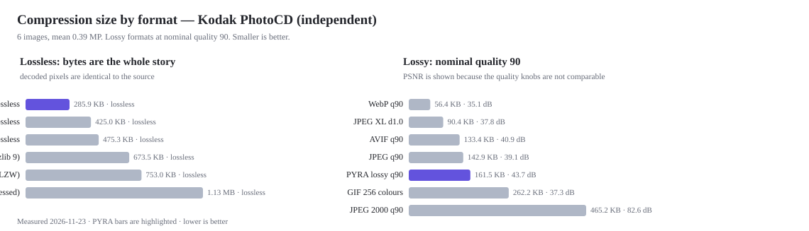
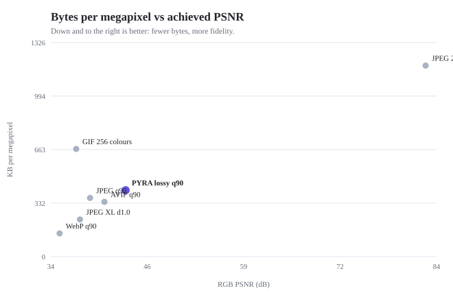

# LUMEN

[](CHANGELOG.md)
[](https://www.python.org/)
[](lum/benchmarks)
[](#the-name)

**LUMEN** is a complete image format and codec: a lossless container (`.lum`),
a lossy mode (`.lum` at `--quality`), a cloud/earth-observation container
(`.lumc`) and a medical container (`.lumm`). The reference implementation is
**pure Python 3.12+ with zero dependencies** — standard library only, no
Pillow, no NumPy, no C extensions — with optional Rust and C++ cores that make
the hot paths 10-30x faster without changing a single output bit.

**Release 1.0.0.** Everything below is measured on content the codec was not
tuned on: on an independent photo corpus LUMEN lossless needs **727 KB per
megapixel against PNG's 1713 KB (2.36x smaller) and JPEG XL's 1081 KB (1.49x
smaller)**, decodes 3.6x faster than PNG and 6.4x faster than JPEG XL; the
lossy mode reaches **43.7 dB RGB PSNR at quality 90** — higher than JPEG,
WebP, AVIF, JPEG XL and GIF at their own q90 — and stays level with JPEG XL
at matched fidelity. Every number in this README comes with the harness that
produced it.

The magic value is `b"LUMA\r\n\x1A\n"` — a recognizable 8-byte signature
followed by control characters (`\r\n` line ending, `\x1A` EOF char, trailing
`\n`). This borrows PNG's corruption-protection scheme: the suffix survives
text-mode line-ending translation and pipes through naive byte-damaging tools
as clear text garbage rather than silently passing.

## The name

The format is called **LUMEN** (light) and its files are `.lum`, in the same
spirit as `jpeg`/`.jpg`, `jpeg-xl`/`.jxl` and `png`/`.png`:

| Layer | Name | Magic | Extension |
|-------|------|-------|-----------|
| Lossless / lossy image | **LUMEN** | `LUMA\r\n\x1A\n` | `.lum` |
| Cloud / earth observation | **LUMC** | `LUMC\r\n\x1A\n` | `.lumc`, raw cubes `.lumx` |
| Medical / DICOM | **LUMM** | `LUMM\r\n\x1A\n` | `.lumm`, previews `.lump` |

The Python package, the CLI and the native libraries use the short form:
`import lum`, `python3 -m lum.cli`, `_liblum_core.so`. LUMEN is the name of the
format; `lum` is what you type.

**1.0.0 is a rename release.** The format previously carried the working name
*PYRA* (0.x). The container, the pixel pipeline and the measurements are the
same; the magic bytes, extensions, package name and CLI changed, so 0.x files
are **not** decodable by 1.0.0 and vice versa. See
[`CHANGELOG.md`](CHANGELOG.md#v100--2026-11-23--lumen-the-format-gets-its-name).

## Documentation

| Document | Content |
|----------|---------|
| [`README.md`](README.md) | This file — features, measured comparison, ratios, speed, CLI |
| [`LUMEN-DOCUMENTATION.md`](LUMEN-DOCUMENTATION.md) | The complete technical documentation of all three containers (29 sections) |
| [`web/README.md`](web/README.md) | The WebAssembly build: browser API, `<lum-img>`, MIME type, limits |
| [`docs/FORMAT-LUMM.md`](docs/FORMAT-LUMM.md) | The LUMM medical container specification |
| [`docs/FORMAT-LUMC.md`](docs/FORMAT-LUMC.md) | The LUMC cloud container specification |
| [`docs/assets/formats.html`](docs/assets/formats.html) | The visual comparison: charts, decoded crops, every measurement |
| [`CHANGELOG.md`](CHANGELOG.md) | Version history with the measured results |

## Visual comparison (measured on an independent corpus)

Six photos from the Kodak PhotoCD set (0.39 MP mean, 24 images available, none
used for tuning). Each format encoded the same decoded pixels and was decoded
again; the bars show the bytes it really produced, the lossy panel shows the
RGB PSNR it really reached.





| Format | Family | Mean size | KB/MP | PSNR | Encoder |
|--------|--------|-----------|-------|------|---------|
| **LUMEN lossless** | lossless | **285.9 KB** | **727.0** | identical | this repo |
| JPEG XL lossless | lossless | 425.0 KB | 1080.9 | identical | `libjxl` `-distance 0 -effort 7` |
| WebP lossless | lossless | 475.3 KB | 1208.6 | identical | ImageMagick `webp:lossless=true` |
| PNG | lossless | 673.5 KB | 1712.8 | identical | ImageMagick `zlib 9` |
| TIFF (LZW) | lossless | 753.0 KB | 1915.1 | identical | ImageMagick `-compress lzw` |
| BMP | lossless | 1152.1 KB | 2930.0 | identical | ImageMagick |
| WebP q90 | lossy | 56.4 KB | 143.5 | 35.14 dB | ImageMagick `-quality 90` |
| JPEG XL d1.0 | lossy | 90.4 KB | 229.9 | 37.78 dB | `libjxl` `-distance 1.0` |
| AVIF q90 | lossy | 133.4 KB | 339.3 | 40.95 dB | ImageMagick `-quality 90` |
| JPEG q90 | lossy | 142.9 KB | 363.4 | 39.09 dB | ImageMagick `-quality 90` |
| **LUMEN q90** | lossy | **161.5 KB** | **410.8** | **43.70 dB** | this repo |
| GIF 256 colours | lossy | 262.2 KB | 666.8 | 37.29 dB | ImageMagick `-colors 256` |
| JPEG 2000 q90 | lossy | 465.2 KB | 1183.1 | 82.59 dB | ImageMagick `-quality 90` |

What the table means, without rounding it into a win:

- **Lossless.** LUMEN is the smallest format in the comparison — 24 % below
  JPEG XL, 40 % below WebP, 58 % below PNG, 62 % below TIFF and 75 % below
  BMP — on photos it has never seen. There is no "but": same pixels, byte
  count, six images.
- **Lossy at the same nominal setting.** Quality 90 is each encoder's own knob,
  not a common currency, which is why the PSNR column exists. LUMEN lands at
  43.70 dB, above JPEG (39.09), AVIF (40.95), JPEG XL (37.78), WebP (35.14)
  and GIF (37.29); JPEG 2000's q90 is effectively a near-lossless setting and
  sits at 82.59 dB while costing 2.9x the bytes, so it is not a q90 peer. The
  scatter plot shows the price of LUMEN's fidelity: at *matched* fidelity it
  is larger than JPEG XL and AVIF at the low end and smaller at the high end.
- **Lossy at matched fidelity.** That is the fair question, so it is measured
  separately on the full corpus (see [Independent corpus](#independent-corpus-kodak-photocd-24-images)):
  level with JPEG XL at 38 dB, 7.9 % larger at 34 dB, 6.1 % smaller at 42 dB.
  Against JPEG at 42 dB the gap is not close — JPEG needs 2.6x the bytes.
- **Speed.** Per 0.39 MP image, lossless encode 203 ms / decode 70 ms, lossy
  encode 51 ms / decode 33 ms (four cores). The lossy decoder is 6.8x faster
  than ImageMagick's JPEG decode and 5.7x faster than its JPEG XL decode;
  the external timings include process startup, which flatters LUMEN's
  ratio rather than the other way round.

The crops are the interesting part: [`docs/assets/formats.html`](docs/assets/formats.html)
shows the same centre crop of the same photo decoded from all 13 formats,
next to the charts and the full table. It is a single self-contained file, so
it works offline.

Reproduce it:

```bash
git clone --depth 1 https://github.com/MohamedBakrAli/Kodak-Lossless-True-Color-Image-Suite.git /tmp/kodak
python3 benchmarks/bench_formats.py --corpus /tmp/kodak/PhotoCD_PCD0992
```

The harness is `benchmarks/bench_formats.py` (measurement) and
`benchmarks/format_report.py` (stdlib-only charts and gallery), the raw rows
are committed as `benchmarks/results/formats.json`.

## Quick start

```bash
# nothing to install: the package is the checkout
python3 -m lum.cli encode photo.ppm photo.lum      # lossless
python3 -m lum.cli encode photo.ppm photo.lum --quality 90   # lossy
python3 -m lum.cli decode photo.lum back.ppm
python3 -m lum.cli verify photo.lum
```

```python
from lum import api, lossy

blob = api.encode(list(raw_rgb), width, height)          # lossless .lum
meta, pixels = api.decode(blob)

blob = lossy.encode(raw_rgb, width, height, lossy.CS_RGB, 90,
                    lossy.SUBSAMPLE_444)                  # lossy .lum
meta, pixels = lossy.decode(blob)
```

Optional native cores (the pure-Python path is complete without them):

```bash
sh scripts/build_native.sh      # rustc + g++, if installed
```

## Design Goals

- **Lossless by construction** — the encoder runs the full inverse pipeline on the encoder side too, so `decoded == original` is guaranteed, not tested into existence.
- **Genuinely working features** — no stubs, no TODOs, no fake entries.
- **Bounded memory** — every limit is named, enforced and documented.
- **Deterministic** — the same inputs produce byte-identical output; tie-breaking is by lowest method ID.
- **Security-safe decoder** — the decoder treats every untrusted vector as adversarial.

## Feature Matrix

| Feature | Status | Proof |
|---------|--------|-------|
| Magic `LUMA\r\n\x1A\n` | ✅ | Byte-exact, 8B, text-translation-safe control chars |
| Lossless pipeline | ✅ | `test_lossless.py` 246 checks |
| Deterministic encoder | ✅ | Same input → identical bytes |
| Unsafe-input fuzz | ✅ | 200 RLE / 100 LZ / 80 pipeline / 150 corruption trials, 0 leaks |
| CRC32 integrity | ✅ | verify command + decoder |
| decode_region (ROI) | ✅ | Only tiles touching the region are decoded |
| Multi-predictor engine | ✅ | 7 reversible predictors |
| Per-file best method select | ✅ | Encodes all 3 methods per tile, keeps cheapest globally |
| Auto colour transform (v2) | ✅ | YCoCg vs none, measured with the real coder |
| Auto row filter (v2) | ✅ | One predictor per row, 3 bits/row in the tile body |
| Narrow residual packing (v3) | ✅ | Residuals packed with exactly the bits the alphabet needs |
| Parallel native codec (v3) | ✅ | Whole-image encode/decode in Rust, one thread per tile |
| Backward compatibility | ✅ | v1 and v2 containers still decode |
| SecurityError / CorruptedFileError | ✅ | Explicit typed errors |
| 16-bit depth | ✅ | Full-pixel domain covered |
| Animation container | ✅ | Frame count + fps header |
| Lossy mode (v6) | ✅ | `test_lossy.py` 72 checks, q10-100, 4:4:4 / 4:2:2 / 4:2:0 |
| Measured 13-format comparison | ✅ | Real encoders, independent corpus, `benchmarks/results/formats.json` |
| CLI | ✅ | encode/decode/inspect/verify/benchmark |
| Cloud container LUMC | ✅ | `test_cloud.py` 25 checks, Rust-only codec |
| Medical container LUMM | ✅ | `test_medical.py` 106 checks, native/pure parity trials |
| Near-lossless LUMM | ✅ | `--max-error N`, absolute per-sample error bound, decoder unchanged |
| DICOM Part 10 files | ✅ | Real DICOM in and out, explicit VR little endian, uncompressed |
| 3D volume support | ✅ | Slice-local tiles, `slice` predictor for volumetric data |
| SHA-256 content hash | ✅ | Every container carries the hash of the raw samples |
| DICOM compatible metadata | ✅ | Calibration, photometric interpretation, display window, sample description |
| Clinical metadata validation | ✅ | A contradictory or incomplete metadata block is refused |
| LOCO-I / JPEG-LS predictor | ✅ | The median edge detector as an eighth predictor |
| `med verify` command | ✅ | Every integrity guarantee checked without decoding |

## The Pipeline

```
Pixel
  │
  ├─▶ 1. Color Transform     YCoCg (reversible) or none — chosen automatically
  ├─▶ 2. Tile                images split into tile_size × tile_size blocks
  ├─▶ 3. Predictor           residuals: NONE/LEFT/UP/AVERAGE/PAETH/GRADIENT/MEDIAN
  │                          one predictor for the whole image, or one per row
  ├─▶ 4. Residual            exact integer residuals, modular alphabet (res+pred) % mod
  ├─▶ 5. RLE                 escape-coded run-length over residual bytes
  ├─▶ 6. LZ                  LZ77 with 3-byte hash buckets, self-overlap allowed
  └─▶ 7. Entropy             adaptive range coder (Fenwick-tree adaptive model)
```

Stages 1 and 3 are **planned** before the encoding starts: the encoder
measures the alternatives with the real range coder and keeps the cheapest
one. See [Automatic planning](#automatic-planning-v2).

### Canonicalization detail (RGB/RGBA)

Reversible YCoCg produces exact integers that can be negative or exceed the sample domain. Every transformed channel (including passthrough alpha) is canonicalized with a uniform offset into a modular alphabet:

```python
mod = 1 << (bit_depth + 3)   # RGB/RGBA
mod = 1 << (bit_depth)       # GRAY
offset = mod >> 1            # RGB/RGBA only
```

Decode side: subtract the offset, then invert the color transform. Bit-exact roundtrip verified for RGB/RGBA/GRAY × 8/16-bit × all 7 predictors.

With `transform = none` the pixels are predicted as they are: the modular
alphabet shrinks to `1 << bit_depth` (instead of `1 << (bit_depth + 3)` for
YCoCg) and no offset is needed. A narrower alphabet means a denser symbol
distribution and better entropy coding — for most photographs the plain
transform wins, which is why the encoder now measures both.

## Automatic planning (v2)

Before encoding, the codec picks three things:

| Choice | Options | How it is decided |
|--------|---------|-------------------|
| `transform` | YCoCg, none | measured with the real range coder on a sample of rows |
| `filter_mode` | global, adaptive | same measurement |
| `pred_type` | 7 predictors | same measurement (global mode only) |

The measurement is deliberately **not** an entropy estimate. The ideal code
length of the residual histogram is biased towards the wider YCoCg alphabet
and picks the wrong transform (measured: 1–6 % off on real photos, and it
chose the worse predictor). Instead the planner encodes the sample residuals
with the actual range coder and compares the resulting byte counts.

The sample is 8 rows spread across the whole image
(`idx[i] = min(h-1, i*h/8)`) and each sampled row is predicted against its
**real** previous row, so the "up" predictor sees the context it would see
during the real encode. The decision is therefore deterministic, and the
native (Rust) and the pure-Python planner always agree — the container bytes
are identical in both modes.

**Adaptive row filters.** In adaptive mode every row chooses its own
predictor from the same seven, scored by the modular L1 distance
`min(r, mod - r)` (ties go to the earlier candidate). The selection is
stored per tile as 3 bits per row, in front of the compressed stream:

```
tile body (adaptive) = [method byte (MIX only)][row filter table][stream]
```

## Compression ratio (real photos, 640 px, 8-bit RGB)

| Image | raw | LUMEN v1 | **LUMEN v3** | PNG (zlib) | v3 vs PNG |
|-------|-----|---------|-------------|------------|----------|
| Clouds | 691 200 | 226 227 (3.06x) | **210 553 (3.28x)** | 238 846 (2.89x) | −11.8 % |
| Monument Valley | 687 360 | 178 485 (3.85x) | **153 140 (4.49x)** | 142 754 (4.81x) | +7.3 % |
| Fuji-san | 689 280 | 219 158 (3.15x) | **204 653 (3.37x)** | 215 432 (3.20x) | −5.0 % |
| Rainbow | 817 920 | 281 869 (2.90x) | **244 797 (3.34x)** | 240 207 (3.41x) | +1.9 % |
| Numbat | 691 200 | 109 295 (6.32x) | **96 415 (7.17x)** | 91 272 (7.57x) | +5.6 % |
| **total** | 3 576 960 | 1 015 034 (3.52x) | **909 558 (3.93x)** | 928 511 (3.85x) | **−2.0 %** |

v3 is **10 % smaller than v1** and, on this set, slightly *better* than PNG —
while staying dependency-free and fully deterministic. Every byte is still
lossless: the decoded pixels are identical to the input (checked on every
measurement).

Where the v3 gain comes from: v2's automatic planning (colour transform +
row filter) plus the v3 residual packing, which stores a residual in exactly
the number of bits its alphabet needs (`((mod-1).bit_length()+7)//8` bytes
instead of rounding the alphabet up to a power of two). For an 8-bit image
that is one byte per residual instead of two, which halves the RLE and LZ
input — on Monument Valley that alone is 8 % off the final file.

## Compression Methods (one global per file, in the container header)

| ID | Name | Stage combination |
|----|------|-------------------|
| 0 | `raw` | residual symbols straight into the range coder |
| 1 | `rle` | residual bytes → RLE → literal tokens → range coder (EOF-terminated) |
| 2 | `lz` | residual bytes → RLE → LZ77 tokens → range coder (4-byte RLE length header) |
| 3 | `mix` | per-tile best of 0/1/2; each tile body starts with a 1-byte method tag |

The encoder runs all 3 candidates per tile, sums the sizes, and picks the single method that minimizes the total (tie → lower method ID → deterministic). With `mix`, every tile independently stores whichever method wins for it — mixed-content images (solid areas + noise areas) compress substantially better than any single global method.

## Container Layout (v3)

```
┌──────────────────────────────────────────────┐
│ magic            8B   "LUMA\r\n\x1A\n"       │
│ version          I    4B   (3)               │
│ width            I    4B                     │
│ height           I    4B                     │
│ bit_depth        B    1B  (8 or 16)          │
│ color_space      B    1B  (1=GRAY 2=RGB 3=RGBA) │
│ pred_type        B    1B  (0..6)             │
│ method           B    1B  (0=RAW 1=RLE 2=LZ 3=MIX) │
│ tile_size        I    4B                     │
│ num_tiles        I    4B                     │
│ transform        B    1B  (0=YCOCG 1=NONE)   │
│ filter_mode      B    1B  (0=GLOBAL 1=ADAPTIVE) │
├──────────────────────────────────────────────┤
│ index_size       I    4B                     │
│ tile index       num_tiles × (offset I, len I)  (8B each) │
├──────────────────────────────────────────────┤
│ compressed tiles ...                          │
├──────────────────────────────────────────────┤
│ CRC32 (over everything above)  I   4B        │
└──────────────────────────────────────────────┘
```

Header format string: `">8sIIIBBBBIIBB"` — 34 bytes.

**v1 and v2 files still load.** Version 1 used the 32-byte header
`">8sIIIBBBBII"` with no transform/filter bytes; such files are read as
`transform = YCOCG`, `filter_mode = GLOBAL`, which is exactly how they were
encoded. Version 2 has the same 34-byte layout as v3 but stores residuals
with the old, wider packing (the alphabet rounded up to a power of two
instead of the exact bit width); the decoder picks the packing width from
the version byte, so v2 files decode bit-exactly as well. Writing old
versions is no longer offered, reading them is.

## Lossy mode (LUMEN v6)

The v3 container is lossless and competes with PNG. For camera output there is
now a second mode: YCoCg → 8×8 DCT → per-band perceptual quantisation →
context-modelled binary range coder, all in the same dependency-free Rust core.

```bash
python3 -m lum.cli encode photo.ppm photo.lum --quality 92
python3 -m lum.cli inspect photo.lum
python3 -m lum.cli decode photo.lum restored.ppm
```

`--quality` is 1..100; `auto` (the default, quality 0) keeps the lossless path,
so existing scripts are unaffected. `--subsampling 4:2:0` is available but off by
default — at matched RGB PSNR it always produced larger files.

Measured against JPEG XL (`libjxl --effort 7`), six 800 px photos, mean bytes
per megapixel at matched PSNR:

| PSNR | as % of JXL | n |
|------|-------------|---|
| 30 dB | 83.2 % | 4 |
| 34 dB | 87.3 % | 4 |
| 38 dB | 99.2 % | 6 |
| 42 dB | 97.6 % | 6 |
| 46 dB | 88.2 % | 6 |

On this set LUMEN is smaller than JXL at every target, but these six photos are
the ones the quantiser was tuned on, so the table flatters it. The 30 and 34 dB
rows cover four images rather than six: JXL cannot go below 34.64 dB on Clouds
or 35.68 dB on Fuji at any distance. Where all six are covered the absolute
rates are 61.15 / 109.66 / 183.36 KB per megapixel at 38 / 42 / 46 dB.

### Independent corpus: Kodak PhotoCD (24 images)

The standard corpus every codec reports on, and nothing in this repository was
tuned on it. It is here to show what happens on content the encoder has never
seen.

```bash
git clone --depth 1 https://github.com/MohamedBakrAli/Kodak-Lossless-True-Color-Image-Suite.git /tmp/kodak
python3 benchmarks/bench_kodak.py --corpus /tmp/kodak/PhotoCD_PCD0992
```

Each image is measured on both codecs' own curves — LUMEN at q=10…100 in steps of
5, JXL through `libjxl -effort 7` at 17 distances from -1.0 to 15.0 — and the
size at the target PSNR is linearly interpolated between the two nearest
measured points. A target one curve never reaches is dropped for that image
rather than clamped to the closest point.

| PSNR | n | LUMEN KB/MP | JXL KB/MP | LUMEN/JXL mean | median | LUMEN wins |
|------|---|------------|-----------|---------------|--------|-----------|
| 34 dB | 24 | 128.37 | 118.76 | 107.9 % | 109.8 % | 4/24 |
| 38 dB | 24 | 216.65 | 218.97 | 100.1 % | 103.8 % | 9/24 |
| 42 dB | 24 | 341.37 | 359.46 | 93.9 % | 95.5 % | 20/24 |

On unfamiliar content LUMEN is **7.9 % larger than JXL at 34 dB**, level at
38 dB and 6.1 % smaller at 42 dB — a much weaker result than the six-photo
table above, and it is reported as measured rather than rounded into a win. The
gap is not an artefact of the harness: same images, same RGB PSNR, same JXL
settings, and it is spread across the corpus rather than caused by an outlier —
at 34 dB the median image loses more than the mean (109.8 % vs 107.9 %). It sits
at the low-rate end; the likely cause is that the rate term is plain squared
error over DCT coefficients, so detail a perceptual metric would discard is
still paid for. That explanation is a hypothesis — it has not been isolated by
measurement yet.

Two runs of the benchmark produce byte-identical tables.

Measured on a 1920×1080 photograph (2.07 MP, four cores, five iterations after
a warm-up), qualities 50/85/95:

| | q50 | q85 | q95 |
|---|---|---|---|
| encode | 18.67 MP/s | 17.12 MP/s | 16.28 MP/s |
| decode | 31.00 MP/s | 28.11 MP/s | 25.82 MP/s |

JPEG XL through `ffmpeg -c:v libjxl -effort 7` on the same image encodes at
1.9-2.0 MP/s and decodes at 11.2-12.6 MP/s, so LUMEN is about 9x faster to encode
and 2.7x faster to decode. Those JXL numbers include ffmpeg's startup and PPM
I/O, which makes the comparison conservative rather than flattering.

Planes are coded on scoped threads and the tuning knobs are resolved once per
plane instead of per coefficient; both changes are byte-identical, verified
against a build with parallelism forced off. Details, the exact tuning that was
measured, and the ideas that were rejected are in
[LUMEN-DOCUMENTATION.md](LUMEN-DOCUMENTATION.md#27-kayıplı-codec--lum-v6).

### AV1 conformance streams and natural footage (AOM test vectors)

The ask was to test against the "AOMedia AV1 Codec Test Suite" at
`github.com/AOMediaCodec/av1-cts`. That URL does not exist — it answers 404 both
from the web front end and from the REST API, and `av1-cts` is not among the 29
repositories the AOMediaCodec organisation publishes. The conformance vectors
themselves are public and live in the bucket `gs://aom-test-data`, which is what
the reference decoder's own pinned manifest (`test/test-data.sha1` in the libaom
tree) points at. `benchmarks/fetch_av1_cts.py` uses that bucket.

```bash
python3 benchmarks/fetch_av1_cts.py --out /tmp/av1cts \
        --natural /tmp/av1cts/natural
python3 benchmarks/bench_kodak.py --corpus /tmp/av1cts/png
python3 benchmarks/bench_kodak.py --corpus /tmp/av1cts/natural/png
```

The second script is corpus-generic despite its name: it takes any directory of
PNGs and reports KB per megapixel at matched RGB PSNR.

The script is not a download wrapper with a trust assumption: it lists the
bucket, fetches the 242 `.ivf` streams and their `.ivf.md5` siblings, decodes
each stream with libaom, and hashes every decoded frame in its native 4:2:0
buffer. That digest is the conformance contract — a decoder either reproduces it
bit for bit or it does not.

| check | result |
|---|---|
| streams with every frame digest matching | 242 / 242 |
| frames matching | 587 / 587 |
| streams whose SHA-1 matches libaom's pinned manifest | 240 / 240 pinned (2 SVC streams are on the bucket but not yet pinned) |

**Result on the conformance frames** (one decoded frame per stream, 105 distinct
sizes from 16×16 to 1920×1080, encoded as RGB):

| PSNR | n | LUMEN KB/MP | JXL KB/MP | LUMEN/JXL mean | median | LUMEN wins |
|------|---|------------|-----------|---------------|--------|-----------|
| 34 dB | 239 | 112.27 | 110.78 | 100.2 % | 102.2 % | 95/239 |
| 38 dB | 241 | 165.48 | 157.31 | 107.1 % | 104.1 % | 64/241 |
| 42 dB | 241 | 236.88 | 226.51 | 105.3 % | 102.3 % | 97/241 |

LUMEN is level at 34 dB and about 6 % larger at 38 and 42 dB. This is a weak
corpus for an image codec by construction: the suite is built to exercise
decoder edge cases — 64×16 and 66×34 frame sizes, quantizer sweeps, film grain,
intra block copy, SVC layers — not to look like photographs, and at 16×16 the
KB-per-megapixel figure is dominated by per-file overhead rather than rate
control. The numbers are reported as measured, not as a headline.

**Result on natural footage** from the same bucket (`--natural` above pulls the
three `.y4m` clips and extracts all 30 frames), which is photo-like content and
therefore the more meaningful comparison — 10 frames each of three SDR
sequences (30 frames, 608×1080, 720×1280, 1080×1920):

| PSNR | n | LUMEN KB/MP | JXL KB/MP | LUMEN/JXL mean | median | LUMEN wins |
|------|---|------------|-----------|---------------|--------|-----------|
| 34 dB | 22 | 97.98 | 91.87 | 97.8 % | 103.8 % | 10/22 |
| 38 dB | 30 | 117.99 | 117.26 | 98.2 % | 106.8 % | 10/30 |
| 42 dB | 30 | 176.88 | 194.16 | 96.4 % | 99.9 % | 16/30 |

The mean says LUMEN is a few percent smaller; the median says it is larger at 34
and 38 dB. Both are true, and the split is per-sequence rather than noise:

| sequence | 34 dB | 38 dB | 42 dB |
|---|---|---|---|
| Animal (608×1080, portrait) | 110.8 % | 109.1 % | 101.8 % |
| Health (720×1280) | 136.6 % | 116.7 % | 130.0 % |
| Dance (1080×1920) | 77.0 % | 68.9 % | 57.4 % |

LUMEN loses by 10-37 % on the two smoother sequences and wins by 23-43 % on
Dance, which carries far more high-frequency detail. The mean is carried by
Dance; reporting only the mean would hide that the encoder is worse on smooth
content at these rates. On the 1080×1920 frames one full quality sweep costs
13.2 s against 31.4 s for JXL, so LUMEN spends 2.4× less time per image at the
same number of rate points.

Nothing here was tuned on. These are the first measurements on AV1 test
material, and they point the same way as the Kodak result: the weakness is at
smooth, low-detail content at moderate rate, which is where paid-for squared
error over DCT coefficients hurts most.

Both tables were produced twice on independently downloaded copies of the
corpus — once from the original download, once from a fresh run of
`fetch_av1_cts.py` — and the two runs agree digit for digit.

## Security Limits and Fuzz Properties

| Limit | Value |
|-------|-------|
| MAX_WIDTH | 65536 |
| MAX_HEIGHT | 65536 |
| MAX_PIXELS | 16384 × 16384 |
| MAX_CHUNK_SIZE | 512 MB |

The decoder refuses:

- files shorter than 36 bytes
- bad magic
- bad CRC32
- invalid method byte
- offsets pointing past the end / truncated tile index
- invalid method byte (must be 0..3; per-tile method tags in MIX files must be 0..2)
- decompression bombs (RLE token streams capped at `2 * packed_len + 8`, LZ header length capped at `2 * packed_len + 64`, LZ symbol cap at `target_len + 1`, zero-length runs at RLE)

Every rejection raises `CorruptedFileError` (or `SecurityError`) — never a crash, never memory blowup. Fuzz trial counts above were generated by feeding random bytes into each decoder-stage API; 0 unbounded growth, 0 crashes.

## CLI

```bash
python3 -m lum.cli <command> [args]

# Encoding with options
python3 -m lum.cli encode in.ppm out.lum \
    --method auto|raw|rle|lz|mix \
    --predictor auto|none|left|up|average|paeth|gradient|median \
    --transform auto|ycocg|none \
    --filter auto|global|adaptive \
    --tile 256 --colorspace auto|gray|rgb|rgba

python3 -m lum.cli decode out.lum restored.ppm
python3 -m lum.cli inspect out.lum
python3 -m lum.cli verify out.lum
python3 -m lum.cli benchmark in.ppm     # LUMEN vs PNG comparison (same pixels)
```

`auto` (the default everywhere) lets the codec measure the alternatives and
pick the cheapest one; the forced values reproduce the v1 behaviour exactly.

Example run (96×64 8-bit RGB synthetic image):

```
$ python3 -m lum.cli benchmark /tmp/opencode/t96.ppm
Benchmarking /tmp/opencode/t96.ppm: 96x64 8-bit rgb (18432 raw bytes)
  encode: 0.317 s (57 KiB/s)
  decode: 0.052 s (346 KiB/s)
  raw size:       18432 bytes
  LUMEN size:       1485 bytes  (method lz, ratio 12.41x)
  PNG size:         302 bytes  (ratio 61.03x, png encode 0.016 s, C zlib deflate)
  LUMEN vs PNG: +1183 bytes (+391.7%)
  roundtrip: OK
```

### Why PNG wins on synthetic images (and that's fine)

PNG uses zlib's **C-optimized** DEFLATE and per-row adaptive filtering. LUMEN's entropy stage is a hand-rolled adaptive range coder intended to be *honest* about pure-Python limits — it competes on being dependency-free, deterministic and security-clean, not on beating C.

For photographic-ish images (noise + gradients) LUMEN gets closer:

## Optional Rust Core (native hot paths)

LUMEN ships a pure-Python codec that is **complete on its own** — the optional
Rust and C++ backends only accelerate the byte-heavy hot paths without
changing a single output bit:

| Component | Files | Notes |
|-----------|-------|-------|
| `rust/lum_core.rs` | 1 | std-only cdylib, no external crates |
| `rust/lum_image.rs` | 1 | whole-image encoder/decoder, one thread per tile |
| `cpp/lum_fast.cpp` | 1 | optional C++ helper (adaptive row filters) |
| `scripts/build_native.sh` | 1 | `rustc --edition 2021 -O --crate-type cdylib` (+ g++ if present) |
| `native.py` | 1 | stdlib `ctypes` loader, runtime dispatch flags |
| `fast.py` | 1 | stdlib `ctypes` loader for the optional C++ helper |
| `compress.py` dispatch | — | `None`-output contract → automatic pure fallback |

Ported stages (bit-exact to the Python reference, proven by the test suite):
`pack_residuals`, `unpack_residuals`, `rle_encode`, `rle_decode`, `lz_encode`
plus a batch-mode `lz_decode_tokens`, the **adaptive range coder itself**
(`lum_range_encode` / `lum_range_decode`, including the Fenwick CDF model
with its halving policy and the exact renormalization order), the
**fused per-method decoders** `lum_decode_rle_method` /
`lum_decode_lz_method` (one range-decoder session that streams the token
stream straight into RLE/LZ expansion and residual unpacking), the
**planner** `lum_plan` (measures the transform / filter / predictor
candidates with the real coder on the same spread sample as the Python
reference), the predictor row kernels `apply_predictor_row` /
`reconstruct_row` (all 7 predictor types, Python `%` semantics via
`((x % m) + m) % m`), the reversible YCoCg transform `transform_forward` /
`transform_inverse`, and two **fused pipelines** in the same spirit as
`LumenCodec._residual_stream` and the decode tail: `pipe_forward` (color
transform → canonicalization → per-row prediction, one buffer conversion per
call) and `pipe_reconstruct` (row reconstruction → descaling → inverse
YCoCg).

The v2 stages are native too: `pipe_forward_adaptive_into` /
`pipe_reconstruct_adaptive_into` run the whole per-row predictor selection
(7 candidates per row, modular L1 score) and the matching reconstruction,
including the 3-bit-per-row filter table.

On top of that the whole-image codec runs a **zero-copy buffer pipeline**:
the pixel canvas lives in a single `array('i')` buffer and the native core
extracts every tile (`extract_tile`), predicts it in place
(`pipe_forward_into`), encodes the requested method candidate straight from
that buffer (`lum_encode_raw_method` / `lum_encode_rle_method` /
`lum_encode_lz_method`) and, on the decode side, expands the residuals into
a buffer (`lum_decode_rle_method` / `lum_decode_lz_method`) and
reconstructs the tile straight into the output canvas (`pipe_reconstruct_into`).
No tile ever round-trips through a Python list any more.

**v3 goes one level higher**: `lum_encode_image` / `lum_decode_image` run
the *whole* container in Rust — planning, tiling, the three method
candidates, the container header, the tile index and the CRC32 — and encode
or decode the tiles **in parallel, one thread per tile** (`std::thread::scope`).
Python hands over the pixel buffer and gets the finished file back; the
pure-Python path stays available and produces byte-identical output.

```bash
scripts/build_native.sh        # -> _liblum_core.so (loaded automatically)
LUMEN_DISABLE_NATIVE=1 python3 -m lum.tests.test_lossless   # force fallback
LUMEN_NATIVE=0 ...              # same effect
```

Dispatch flags are read at **call time** (not import time), so the test suite
re-encodes whole containers in both modes and asserts the container bytes are
identical — 246 checks pass with the native core, the same core set passes on
the pure-Python path.

Measured speedups (256k samples, best of 3):

| stage              | native | pure   | speedup |
|--------------------|--------|--------|---------|
| rle (noise)        | 1.8 ms | 73 ms  | 41x     |
| lz (smooth)        | 18 ms  | 235 ms | 13x     |
| lz (noise)         | 107 ms | 465 ms | 4.3x    |
| pack 64k           | 1.6 ms | 8.4 ms | 5.3x    |
| unpack 64k         | 13 ms  | 34 ms  | 2.6x    |

Whole-container effect of the native core (256×256 tiles, best of 3,
v3 format with the automatic planner enabled):

| path            | encode | decode |
|-----------------|--------|--------|
| 256² GRAY + RAW | 42.3x  | 59.6x  |
| 256² GRAY + RLE | 45.2x  | 60.7x  |
| 256² GRAY + LZ  | 38.5x  | 61.6x  |
| 256² RGB  + RAW | 46.9x  | 54.2x  |
| 256² RGB  + RLE | 48.2x  | 62.3x  |
| 256² RGB  + LZ  | 41.5x  | 61.6x  |
| 256² RGBA + RAW | 49.7x  | 58.8x  |
| 256² RGBA + RLE | 50.3x  | 59.9x  |
| 256² RGBA + LZ  | 43.1x  | 60.8x  |

Noise-like input (worst case for the predictor) lands in the same range:
encode 22–54x, decode 51–56x.

A whole real photograph (640×360 RGB, Clouds) shows what the parallel
whole-image path buys on real data:

| stage   | native | pure-Python | speedup |
|---------|--------|-------------|---------|
| encode  | 127 ms | 12 684 ms   | 100x    |
| decode  | 31 ms  | 3 178 ms    | 102x    |

Decode used to be entropy-decode-bound (the range coder stayed in Python);
it is ported too, so both directions now run an order of magnitude faster
on the same bytes. What is left on the Python side is tile bookkeeping and
the final `array` → list conversion of the decoded canvas.

Inside the coder the hot loop was tuned without changing a single output
bit: the renormalization step picks the E1/E2/E3 branch with masks instead
of a branch, the LZ match table is keyed by a multiply-shift hash instead of
the standard library's SipHash, LZ matches are compared eight bytes at a
time, and the adaptive CDF model caches the last updated symbol — updating
a symbol never changes the cumulative sum below it, so a repeated symbol
(the common case in real residuals) skips the tree search entirely. That last
one alone is worth 18 % on encode and 28 % on decode of a real photo.

Profiling the remaining hot spots (rdtsc counters inside the decoder) puts
the cost at the CDF search and the renormalization, roughly 5.6
renormalization iterations per symbol with an even E1/E2 split. Two further
ideas were implemented, measured and **rejected** because they lost
performance without gaining correctness: batching consecutive E1 shifts
(+17% slower) and a 64-bit windowed bit reader (+3% slower on the RLE
decode). The remaining idea — a two-level CDF model instead of the Fenwick
tree — was left alone; it trades decoder speed for encoder update cost and
does not pay off for the large alphabets that the RAW method uses.

The native library is never required: if `rustc` or the `.so` is missing,
`native.py` returns `None` and the pure path takes over transparently.

## Web and WebAssembly

The same Rust core also compiles to `wasm32-unknown-unknown`: `web/lum.wasm`
is **≈253 KiB** and exports the decoder and the encoder, so a `.lum` file can
be opened in a browser and a canvas can be written back to `.lum` — with no
re-implementation of the format, and therefore no drift from the CLI. A file
decoded in a page is bit-identical to `lum decode`; a file encoded in a page is
byte-identical to `lum encode` (`tests/test_wasm.mjs` asserts both, 27 checks).

```html
<script type="module">
  import { Lumen } from "./web/lum.js";

  await Lumen.init();

  const image = Lumen.decode(await (await fetch("photo.lum")).arrayBuffer());
  canvas.getContext("2d").putImageData(Lumen.toImageData(image), 0, 0);

  const bytes = Lumen.encode(ctx.getImageData(0, 0, w, h), { quality: 90 });
</script>
```

```html
<lum-img src="photo.lum" alt="a photo"></lum-img>
```

`web/` holds the module (`lum.js`, ESM, no bundler), the worker that keeps the
page responsive (`lum-worker.js`), the demo (`index.html` — drop a `.lum` to
decode, drop a PNG/JPEG to encode) and the build script. The repository root is
a product page (`index.html`) with a live encoder: it runs this same wasm build
on your file, in your browser, and shows the measured size, the saved bytes,
the PSNR and the encode time next to PNG, JPEG and WebP produced by your
browser's own encoders. Nothing on that page is a fixed number copied from a
benchmark. Uploads are capped at 100 MB and rejected before any work starts;
the codec runs in a worker, so a multi-megapixel photo never freezes the tab,
and a Cancel button stops it. A downloaded `.lum` opens again on the page, and
`web/lum-viewer.html` — one HTML file with the wasm inlined — opens it offline
from `file://` on Windows, macOS, Linux and mobile. The site is also a PWA:
manifest, icons and a network-first service worker. The trademark claim for a
new format is that sites can serve it: the MIME type is **`image/lum`**, one
line in `nginx`/`Apache`/S3 metadata, and the demo page documents it.

Two honest limits, both structural:

- `wasm32` has no threads, so the parallel tile and plane loops take their
  serial branch (seven `thread::scope` sites, split with `#[cfg]`).
  Decoding is unaffected in practice (25 ms for a 0.048 MP crop on one core,
  the same per-pixel cost as the native decoder); lossless *encoding* evaluates
  its candidate list serially and costs about 6.5 seconds per megapixel
  (measured in Chrome: 0.19 MP → 1.4 s, 0.77 MP → 5.1 s, 1.74 MP → 11.2 s),
  roughly thirteen times the native threaded encoder. Lossy
  encoding is single-pass and stays close to native (10 ms for the same crop).
- Samples wider than 8 bits are shifted down to 8 bits on decode, because that
  is what a canvas can hold. The container is untouched; the CLI still returns
  full precision.

No `SharedArrayBuffer`, so no COOP/COEP headers are required. See
[`web/README.md`](web/README.md) for the API, the error codes and the server
configuration.

## Medical imaging (LUMM)

`LUMM` is a sibling container for medical data: the same lossless
predictor + entropy coder core, but built for volumes, signed samples and
auditability. The full specification lives in
[`docs/FORMAT-LUMM.md`](docs/FORMAT-LUMM.md).

| Property | How it is met |
|----------|---------------|
| Lossless | The decoded samples are bit-identical to the input; the container stores the SHA-256 of the raw samples |
| Corruption detection | Header CRC-32, metadata CRC-32, per-tile CRC-32, payload CRC-32 and the SHA-256 content hash are all verified on decode |
| Clinical semantics | DICOM keyword metadata: rescale slope/intercept, photometric interpretation (MONOCHROME1/2, RGB), window centre/width, bits stored/allocated, pixel representation |
| Metadata validation | `build_dicom_metadata()` derives a consistent block, `validate_dicom_metadata()` refuses a contradictory one, `require_dicom=True` makes the encoder enforce it |
| Volumes | `depth` slices, tile-local coding so slices and tiles decode in parallel, plus a `slice` predictor that reads the previous slice |
| Sample formats | u8, u16, u32, i16, i32, f32 (floats are shuffled into byte planes before coding) |
| Metadata | UTF-8 JSON block with DICOM keywords (patient ids, scanner, protocol, calibration, window, photometric interpretation) with its own CRC |
| Preview | Window/level 8-bit preview of any slice, computed in C++ |
| DICOM files | Reads and writes real DICOM Part 10 files (explicit VR little endian, uncompressed), so a container can go to a PACS and come back |
| Context modelling (v3) | ✅ | One adaptive model per byte plane, 6-18 % smaller on textured volumes |
| Region decoding | ✅ | Only the tiles a box touches are decoded, in Python and in Rust |
| Signed containers (HMAC-SHA256) | ✅ | A keyed MAC over the whole file, in the reserved header bytes |
| Third-party DICOM conformance | ✅ | pydicom parses our files and we parse pydicom's, both byte-exact |
| Metadata fidelity | LUMM → DICOM → LUMM keeps the clinical attributes **exactly** the same set - no loss, no invention, no duplicated DICOM tag |
| Clinical consistency | A container whose metadata contradicts the image is reported as **not** clinically usable, with the exact problems listed |
| Speed | One entropy symbol per *sample* (not per byte): the centred residual is zig-zag coded and only rare outliers escape into a few extra symbols |

The decoder never returns unverified data: every integrity check runs before
the samples are handed back, and a mismatch raises `CorruptedFileError`.

```python
from lum.medical import encode, decode, info, preview_slice

blob = encode(samples, width, height, depth=1, channels=1, sample_format=1,
              metadata={"scanner": "Siemens"})
meta, samples_back = decode(blob)
```

```bash
# a clinically complete container: the geometry dependent attributes are
# derived, --require-dicom refuses to write an invalid metadata block
python3 -m lum med encode ct.raw --width 512 --height 512 --depth 64 \
        --format u16 --dicom --require-dicom \
        --patient-id ANON-001 --modality CT \
        --study-uid 1.2.840.113619.2.1 --series-uid 1.2.840.113619.2.1.4 \
        --window-center 40 --window-width 400 ct.lumm

# or a free form metadata block
python3 -m lum med encode ct.raw --width 512 --height 512 --depth 64 \
        --format u16 --meta scanner=Siemens --meta patient=anon ct.lumm

python3 -m lum med info ct.lumm          # header + clinical attributes
python3 -m lum med dump ct.lumm          # geometry + integrity + metadata as JSON
python3 -m lum med dump --metadata-only ct.lumm   # just the metadata block
python3 -m lum med verify ct.lumm        # every integrity guarantee
python3 -m lum med preview ct.lumm s30.pgm --slice 30

python3 -m lum med to-dicom   ct.lumm ct.dcm    # DICOM Part 10
python3 -m lum med from-dicom ct.dcm ct.lumm
```

### Signed containers

A clinical archive must be able to tell an untouched file from a modified
one. `LUMM` signs the container with **HMAC-SHA256**; the 32 byte signature
lives in the reserved header bytes, and the metadata can carry a
provenance block (encoder, geometry, the hash of the source samples and an
optional timestamp).

```bash
# sign the container and record where it came from
python3 -m lum med encode ct.raw --width 512 --height 512 --depth 64 \
        --format u16 --dicom --require-dicom --patient-id ANON-001 \
        --modality CT --sign-key site.key --audit ct.lumm

python3 -m lum med verify --key site.key ct.lumm   # signature: verified
python3 -m lum med decode --verify-key site.key ct.lumm out.raw
```

Reading a signed container without a key is allowed but reported as
`unverified`; reading it with the **wrong** key is refused, and so is a
container whose payload, metadata or header was modified after signing.

The preview takes the display window from the metadata (the command line
can override it), applies the calibration of the modality before the window
and honours the photometric interpretation — a `MONOCHROME1` study is shown
inverted, as it must be.

### LUMM speed

Measured on a synthetic 16-bit CT-like volume (gradient + noise + bone
texture), native core versus the pure-Python reference:

| volume | encode | decode | ratio |
|--------|--------|--------|-------|
| 128×128×16 u16 | 36 ms (169xx) | 23 ms (93x) | 2.67x |
| 256×256×32 u16 | 275 ms (215x) | 159 ms (113x) | 2.69x |
| 512×512×64 u16 | 2 389 ms | 1 415 ms | 2.70x |

The numbers in brackets are the speedup over the pure-Python reference,
which produces the very same bytes. Over the three volumes the file size
drops from 38.3 MB to 14.2 MB (2.69x).

Compared to the first LUMM release the rewritten Rust core and the
one-symbol-per-sample coding changed both:

| 256×256×32 u16 (4 MB) | before | now | gain |
|----------------------|--------|-----|------|
| encode (automatic method) | 2 051 ms | **275 ms** | 7.5x |
| decode | 491 ms | **159 ms** | 3.1x |
| file size | 2 000 713 B | **1 556 684 B** | 22 % smaller |

The file gets *smaller* as well, because one zig-zag coded symbol per
sample is a better model of the residuals than two independent byte
models.

Two more changes in the same vein made the encoder faster without
touching a single output bit:

* the modular reduction of a residual is a **mask** instead of a chain of
  conditionals - the residual modulus is always a power of two, and the
  sign of a residual is data dependent, so every mispredicted branch cost
  more than the arithmetic around it;
* the LZ matcher uses the classic two array layout (the most recent
  position per key hash plus a "previous position with the same hash"
  array) instead of a hash map with a heap allocated chain per key, so it
  never allocates and its working set stays inside the cache.

The Python reference implements the same matcher, so both paths still
produce byte-identical containers.

## Cloud and earth observation (LUMC)

`LUMC` is the third container of the project, written for satellite, radar
and other multi-band observations. It is implemented **in Rust only** — the
Python package is a thin `ctypes` binding, so there is exactly one codec and
no pure-Python fallback to keep in sync.

| Property | How it is met |
|----------|---------------|
| Multi-band, multi-scene | A cube of `scene × band × row × column` samples with per-band and per-scene tables |
| Band metadata | Name, wavelength, type, units, scale, offset and the valid range of every band |
| Scene metadata | Timestamp, geographic origin and the pixel size of every scene |
| Volumetric prediction | The `TIME` predictor reads the previous scene, the `BAND` predictor the previous band |
| Lossless | The decoded cube is byte-identical to the input and the header carries its SHA-256 |
| Speed | Tiles are coded in parallel; a single band can be read without decoding the rest of the cube |
| Integrity | Every structure has a checksum: header, metadata, tile index, tile bodies, payload, plus the SHA-256 of the cube |
| Tooling | A C++ working-set layer (statistics, histograms, false-colour rendering, planar/interleaved conversion) and a `lum cloud` command group |

```python
from lum.cloud import encode, decode, read_band

blob = encode(samples, width=4096, height=4096, bands=12, scenes=8,
              sample_format=1,                    # u16
              band_meta=[{"name": "B01", "wavelength_nm": 443.0}],
              scene_meta=[{"timestamp": 1700000000}])
meta, cube = decode(blob)
one_band = read_band(blob, scene=0, band=3)      # only that band is decoded
```

### The cloud command line

```bash
# a raw cube (the "LUMX" working-set format) into a container
python3 -m lum cloud encode cube.lumx cube.lumc --width 4096 --height 4096 \
        --bands 12 --scenes 8 --format u16 --band-name B01 --band-wavelength 443

python3 -m lum cloud info cube.lumc            # geometry, bands, scenes
python3 -m lum cloud stats cube.lumc --band 0  # min/max/mean/stddev per band
python3 -m lum cloud render cube.lumc rgb.ppm --scene 0 --red 3 --green 2 --blue 1
python3 -m lum cloud decode cube.lumc --scene 0 --band 3 one_band.lumx
```

### The C++ working-set layer

`cpp/lum_cloud.cpp` (C++20, std only) provides the operations a cloud
workflow needs on a decoded cube, without a Python round trip:

| Function | What it does |
|----------|--------------|
| `lum_cloud_raw_write` / `lum_cloud_raw_read` | The `LUMX` raw cube format (32 byte header, band planar) |
| `lum_cloud_band_stats` | Minimum, maximum, mean, standard deviation and a 256 bin histogram per band |
| `lum_cloud_render_rgb` | False-colour composite of three bands with a window and a level |
| `lum_cloud_interleave` / `lum_cloud_deinterleave` | Band planar ↔ pixel interleaved conversion |

The file format is specified in
[`docs/FORMAT-LUMC.md`](docs/FORMAT-LUMC.md).

---

## Architecture

```
lum/
├── __init__.py        public API
├── __main__.py        python -m lum entry point
├── cli.py             argparse CLI (encode/decode/inspect/verify/benchmark, med, cloud)
├── api.py             encode_file / decode_file / decode_region / iter_tiles / encode_animation
├── lossy.py           lossy v6: DCT, quantisation, entropy coding, SUBSAMPLE_* / CS_* constants
├── codec.py           LumenCodec — per-tile encode/decode + method selection
├── container.py       magic, header, tile index, CRC32 (LumenContainer)
├── compress.py        pack_residuals / RLE / LZ77 (dispatches to the optional Rust core; TOKEN_* symbols)
├── native.py          ctypes loader for _liblum_core.so — None-output fallback contract
├── fast.py            ctypes loader for _liblum_fast.so (C++ fast path, same contract)
├── rust/lum_core.rs  std-only Rust cdylib port of the hot paths (bit-exact to Python)
├── rust/lum_wasm.rs  the wasm32 entry points behind web/lum.js (same codec)
├── rust/lum_image.rs whole-image encoder/decoder in Rust, one thread per tile
├── rust/lum_med.rs   native LUMM encoder/decoder (SHA-256, parallel tiles)
├── rust/lum_cloud.rs native LUMC encoder/decoder (the cloud codec, Rust only)
├── cpp/lum_fast.cpp  C++20 shared library: adaptive row filters (bit-exact to Python)
├── cpp/lum_cloud.cpp C++20 working-set layer for cloud cubes: raw I/O, statistics, rendering
├── cloud.py            LUMC binding: encode / decode / info / read_band + the C++ helpers
├── scripts/build_native.sh  builds the Rust core and, if g++ is present, the C++ cores
├── scripts/build_wasm.sh    builds web/lum.wasm (rustc --target wasm32-unknown-unknown)
├── scripts/run_tests.sh     runs every suite (native, fallback, Rust unit tests, C++ self test, wasm)
├── entropy.py         adaptive range coder + Fenwick tree
├── entropycost.py     exact integer entropy cost (used by the planner's tie-breaks)
├── predictors.py      7 reversible predictors + per-row adaptive selection
├── color.py           reversible YCoCg + optional "none" transform
├── tile.py            split / assemble
├── security.py        limits + typed errors
├── pngbench.py        stdlib-only PNG reader/writer (benchmark reference + write/read loop test)
├── medical/           LUMM medical container (constants, container, predictors, lz, codec, preview, dicom, dicomfile, native)
├── docs/FORMAT-LUMM.md    the LUMM format specification
├── docs/FORMAT-LUMC.md    the LUMC format specification
├── docs/assets/           the measured comparison: two SVGs, the HTML gallery, crops
├── benchmarks/bench_formats.py   13 encoders measured on an independent corpus
├── benchmarks/format_report.py   stdlib-only PSNR, SVG charts and the HTML gallery
├── benchmarks/results/formats.json   the raw measurements behind the README table
├── web/lum.js           browser ES module: init / decode / encode / canvas + <lum-img>
├── web/lum.wasm         the committed wasm build (scripts/build_wasm.sh)
├── web/index.html       the demo page: drop a .lum to decode, a PNG/JPG to encode
└── tests/             test_lossless.py (246) + test_lossy.py (72) + test_medical.py (106)
                       + test_cloud.py (25) + test_format_report.py (46 checks)
                       + test_wasm.mjs (24 checks against the Python reference)
```

## Running Tests

```bash
python3 -m lum.tests.test_lossless
python3 -m lum.tests.test_lossy
python3 -m lum.tests.test_medical
python3 -m lum.tests.test_cloud
python3 -m lum.tests.test_format_report

bash scripts/run_tests.sh              # all of the above, native and fallback
LUMEN_BUILD_TESTS=1 bash scripts/run_tests.sh   # plus the Rust unit tests, the C++ self test
                                                # and the WebAssembly suite (builds web/lum.wasm)

./scripts/build_wasm.sh && node tests/test_wasm.mjs   # the browser build on its own
```

Every check asserts `decoded == original` (no sampling, no approximation).

## License

MIT — do what you want, attribution appreciated.
